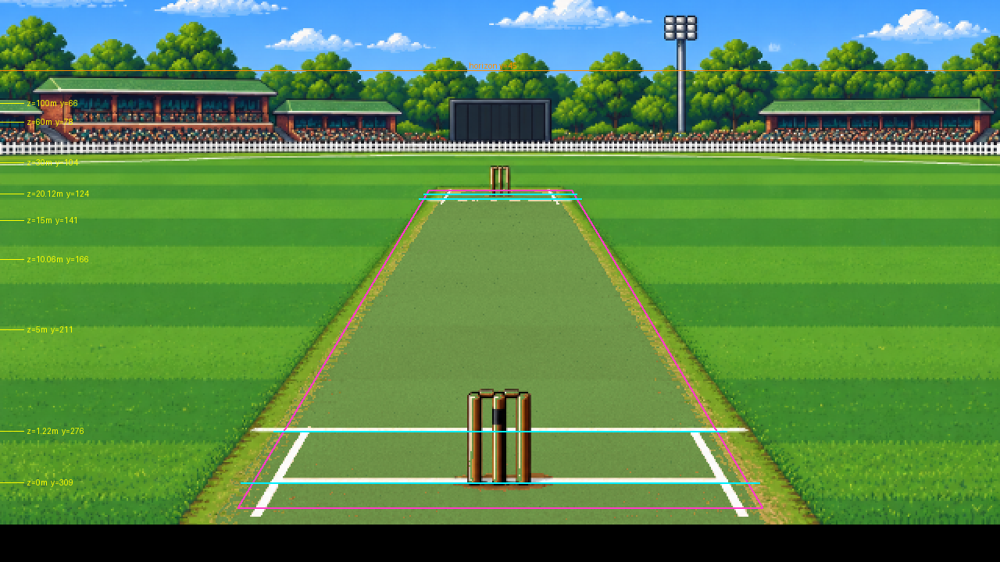
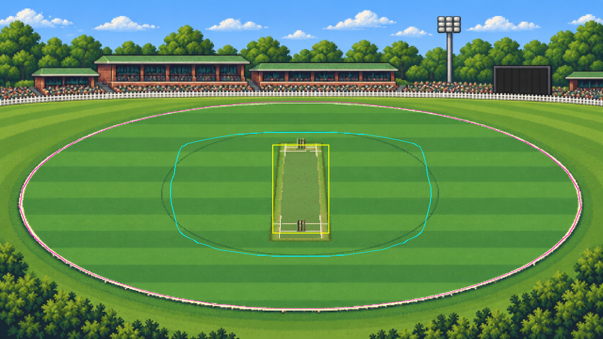
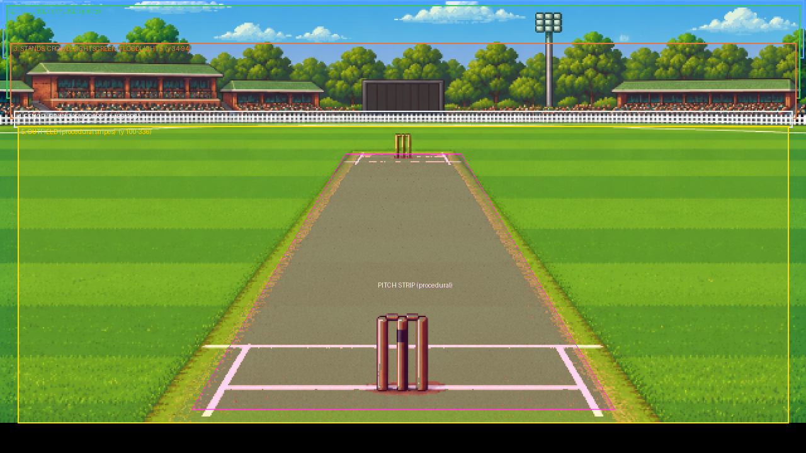
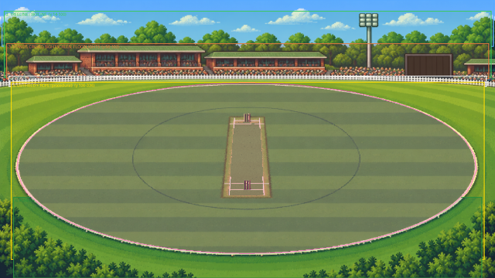

# Cricket Lab asset guide

How the ground art works today, the coordinates the game depends on, and a plan for breaking the
two paintings into layers so grounds can be varied, partly generated in code, and still look hand-made.

All images referred to here are in `docs/assets/`.

---

## 1. What exists now

| File | Size | Used for |
| --- | --- | --- |
| `assets/ground-close.png` | 640 × 360 | The close view down the pitch (used from both ends) |
| `assets/ground-wide.png` | 640 × 360 | The wide view of the whole ground |

Both are single flat paintings. Everything else (players, ball, fielders, stumps when broken, the
HUD, footmarks) is drawn in code on top of them.

**Native resolution.** The game renders to a 640 × 360 buffer and scales it up with no smoothing, so
one pixel in these files is one game pixel. Draw at exactly that size.

**The close painting is drawn 24 px higher than its file.** It is placed at `y = -24`
(`CLOSE_Y_OFFSET` in `src/render/camera.js`), so file row 24 is screen row 0, and the bottom of the
HUD (screen rows 324–359) covers file rows 348–359. When this guide gives close-view positions they
are **screen** coordinates; add 24 to get the row in the file.

**The near stumps are cut from the close painting.** `cutOutStumps()` in `src/main.js` lifts the
striker's stumps out of the file so they can be drawn in front of the batter. Keep them where they are
(file rows 270–333, columns 296–343: a 48 × 64 region; it's drawn back at screen (296, 246)) or give them their own file (see §4).

---

## 2. The contract: positions the game relies on

The camera projections in `src/render/camera.js` were tuned to these paintings. Anything a ball or
player interacts with must sit exactly where the projection puts it. These are the numbers to draw to.

### Close view (screen coordinates; add 24 for the file row)



Magenta: the pitch strip as the game sees it. Cyan: popping and bowling creases. Yellow: the ground
row for each distance down the pitch. Orange: the horizon.

| Distance from the striker's stumps | Ground row (y) | Pitch edges (x, ±1.52 m) | Return creases (x, ±1.32 m) |
| --- | --- | --- | --- |
| 0 m (striker's stumps) | 309 | 162 – 478 | 181 – 459 |
| 1.22 m (popping crease) | 276 | 181 – 459 | 199 – 441 |
| 10.06 m (mid-pitch) | 166 | 247 – 393 | 256 – 384 |
| 18.9 m (far popping crease) | 127 | 271 – 369 | 277 – 363 |
| 20.12 m (bowler's stumps) | 124 | 273 – 367 | 279 – 361 |
| 30 m | 104 | — | — |
| 60 m | 78 | — | — |
| horizon | 45 | — | — |

- Centre line of the pitch: **x = 320**.
- Far stumps: base at **(320, 124)**, top at **(320, 106)**.
- Ground row for any distance z (metres): `y = 69.2 + 2250 / (z + 8.53) - 24`.
- Across the pitch: `x = 320 + w(x) × 880 / (z + 8.53)`, where `w` widens the stumps slightly
  (see `warpLateral`).

Note the current painting draws the pitch a little wider than the projection near the camera. That's
harmless today, but it's one reason to draw the pitch in code (§4).

### Wide view (screen = file coordinates)



Magenta: the boundary rope (66 m). Cyan: a true 30-yard (27.4 m) circle. Yellow: the pitch.

| Landmark | Screen position |
| --- | --- |
| Centre of the pitch | (319, 200) |
| Striker's stumps / bowler's stumps | (319, 246) / (319, 154) |
| Pitch strip corners | x 289 – 349, y 153 – 247 |
| Boundary, straight near / far | (319, 328) / (319, 107) |
| Boundary, square either side | (24, 200) / (613, 200) |
| Rope ellipse | centre (318.5, 215), radius 297.5 across, 108 far side / 113 near side |

The painted rope matches the game's boundary. The painted inner circle does **not** match a true
30-yard circle, but nothing in the game uses it yet.

---

## 3. Palette and style


The main colours of each painting, most common first. Keep new art inside these families so layers
from different sources sit together.

- **No anti-aliasing.** Hard pixel edges only. Smooth with dithering or extra hand-placed shades.
- **Light from the upper left.** The player sprites are lit from the left with shadow on the right;
  stands, trees and fences should agree.
- **Grass:** two alternating stripe greens plus a darker rough at the edges. The stripes are what make
  the field read as mown, so keep their contrast.
- **Outlines:** dark coloured outlines (deep green, brown), not black, on scenery.
- **Transparency:** layers that sit on top of others need a real alpha channel, with fully
  transparent or fully opaque pixels only (no soft edges).

---

## 4. The plan: layers

Each view becomes a stack of layers, drawn back to front. Some stay hand-painted; the parts that must
line up with the game's geometry, or that should change from match to match, get drawn in code.

### Close view



| # | Layer | Screen rows | Made by | File (proposed) | Notes |
| --- | --- | --- | --- | --- | --- |
| 1 | Sky | 0 – 46 | Code + art | `close/sky.png` (640 × 70) | Gradient in code; time of day and weather shift it |
| 1b | Clouds | 0 – 40 | Art, placed by code | `clouds.png` sheet, 8–12 clouds | Drift slowly; a different set each match |
| 2 | Treeline / skyline | 4 – 78 | Art | `close/trees-*.png` (640 wide, transparent) | Swap per ground (gum trees, city skyline) |
| 3 | Stands, sightscreen, floodlights | 34 – 94 | Art | `close/stands-*.png` (640 wide, transparent) | Sightscreen centred on x = 320 |
| 3b | Crowd | inside the stands | Code + art | `crowd.png` sheet (see below) | Spectators placed in seat rows; can cheer |
| 4 | Fence / advertising boards | 88 – 101 | Art | `close/fence-*.png` (640 × 16) | Boards can carry sponsor art |
| 5 | Outfield | 100 – 336 | **Code** | — | Mowing stripes at the ground rows above |
| 6 | Pitch strip | trapezoid | **Code + texture** | `pitch-*.png` tiles (32 × 32) | Grass, dust or cracks by pitch type; wear and footmarks |
| 7 | Creases | lines | **Code** | — | Drawn straight from the projection, always exact |
| 8 | Stumps | near end | Art | `stumps.png` (+ broken frames) | Replaces the cut-out |

### Wide view



| # | Layer | Screen rows | Made by | File (proposed) | Notes |
| --- | --- | --- | --- | --- | --- |
| 1 | Sky + clouds | 0 – 60 | Code + art | shared with close view | |
| 2 | Treeline / skyline | 14 – 100 | Art | `wide/trees-*.png` (640 wide) | |
| 3 | Stands, sightscreen, scoreboard, floodlights | 56 – 102 | Art | `wide/stands-*.png` (640 wide) | Crowd as in the close view |
| 4 | Fence | 98 – 112 | Art | `wide/fence-*.png` | |
| 5 | Outfield + rope + 30-yard circle | 106 – 336 | **Code** | — | Stripes, rope ellipse and inner circle from the projection |
| 6 | Pitch | rectangle | **Code + texture** | shares the pitch tiles | |
| 7 | Foreground trees | 255 – 360 corners | Art | `wide/foreground-*.png` | Frames the scene; optional |

### Sprite sheets

| Sheet | Cell size | Contents |
| --- | --- | --- |
| `crowd.png` | 4 × 6 px | 16+ spectators: shirt colours, hats, sitting and standing (cheering) frames |
| `clouds.png` | free size, transparent | 8–12 clouds of different sizes |
| `stumps.png` | 48 × 64 | Standing, bails flying (3 frames), broken |
| `pitch-*.png` | 32 × 32, tileable | green, dust, cracked, plus a worn overlay |

### What the code would generate

- **Outfield stripes:** bands of alternating green between the ground rows for chosen distances, so
  stripes always narrow correctly towards the horizon. Stripe width, direction and colours become
  per-ground data.
- **Pitch strip:** the trapezoid from the projection, filled with the pitch tile for the pitch type,
  then darkened as it wears. The footmarks the game already draws go on top.
- **Creases, rope, inner circle:** lines straight from the projection, so they're always exact.
- **Crowd:** spectators stamped into the seat rows from the crowd sheet, with colours varied by a
  seed. Fuller for big matches, sparse for a county game, standing up on a wicket or six.
- **Sky:** gradient by time of day (morning, afternoon, evening, floodlit) with clouds drifting.

### Grounds as data

A ground then becomes a small data entry, much like the Classic Matches:

```js
{
  id: "harbour",
  name: "HARBOUR OVAL",
  trees: "gums",          // which treeline art
  stands: "members",      // which stand art (close + wide)
  fence: "pickets",
  stripes: { width: 6, light: "#5fa62e", dark: "#449131" },
  crowd: 0.8,             // how full
  sky: "afternoon",
}
```

---

## 5. Working on the art

1. Start from the two existing paintings and cut them into the layers above. Aseprite, Photoshop
   or Pixelorama all work; set the canvas to 640 × 360 and keep each layer on that full canvas.
2. Export each layer as a PNG at full canvas size with transparency. That's the simplest way to keep
   everything aligned, at the cost of some empty pixels. They can be trimmed later.
3. Check alignment against the overlay images in `docs/assets/`: anything the ball or players touch
   (pitch, creases, stumps, rope) must land on the marked lines.
4. Put the files in `assets/close/`, `assets/wide/` and `assets/sprites/`, then ask for the layer
   compositor to be wired up. Until then the game keeps using the two flat paintings, so nothing
   breaks while the art is in progress.

### Regenerating the overlay images

The landmark and layer images are produced from the live projection code, so they stay correct if
the camera is ever retuned. Ask for "regenerate the asset overlays", or see the script in the commit
that added this guide.
